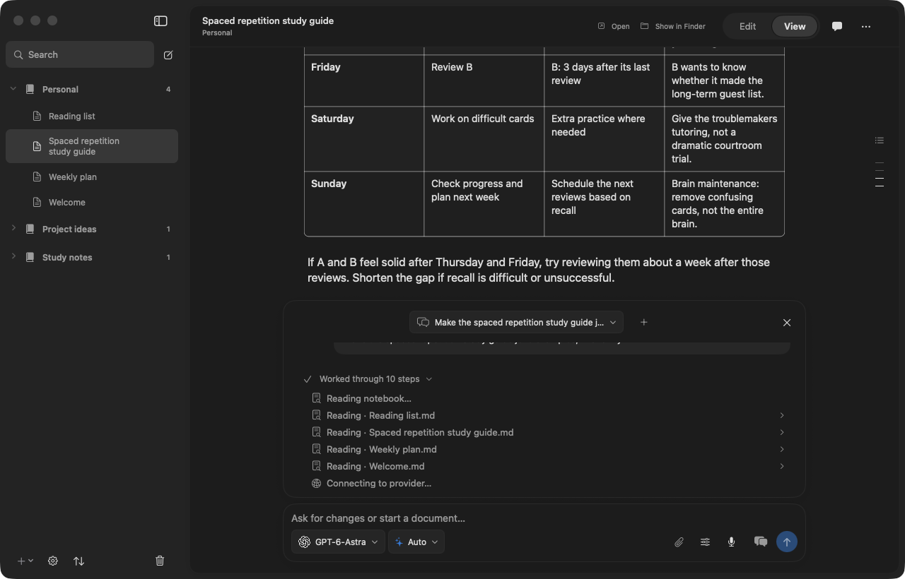

# Palladium

Palladium is a native macOS notebook app for Markdown notes, AI-assisted editing, and chat dictation. It brings your documents and conversations into a calm workspace, whether you’re studying, collecting ideas, or working through a project.



- **Notebooks and Markdown.** Organize notes into notebooks and folders. Write and read formatted Markdown with tables, checklists, math, and images. Paste or drag pictures into notes and resize or crop them visually, with autosave and undo.
- **Notebook chats.** Work with an assistant that can use your notebook’s context, search the web, and help edit documents. Web access starts enabled; switch it off in each notebook’s Profile settings. Attach images, PDFs, or text files when a conversation needs them.
- **Local or API dictation.** Speak into the chat composer using a local Whisper model or the OpenAI API. Review and edit the resulting text before sending. Manage models and your API key in Preferences.
- **Your own appearance.** Choose light, dark, or system appearance, adjust the theme and accent colors, and use compact mode when you want more room for your notes.

## Run locally

Requires **macOS 14 or later**, Xcode with **Swift 6**, and **Python 3**. From the repository root:

```sh
python3 scripts/init-demo-workspace.py .local-demo
zsh scripts/build-app.sh "$PWD/.local-demo"
zsh scripts/run.sh
```

The first command creates an independent workspace with invented content; run it once on a new or empty directory. The build produces `build/Palladium.app`. Local builds use ad-hoc signing and are not notarized releases. Dictation models and the local runtime are installed separately through Preferences; API dictation requires your own key. AI chat also requires a configured provider.

## Your data

Notes and chats are stored locally. When you use an external AI provider, the content needed for that request is sent to the selected service. Web searches send the query to the search service, and page/image requests contact their source sites. API dictation sends audio to OpenAI; local dictation runs on your Mac.

See the [developer guide](docs/development.md) for architecture, testing, and workspace details.

## License

Palladium is available under the [MIT license](LICENSE). Third-party components retain their [license and copyright notices](docs/development.md#third-party-notices).
# Document output

- Markdown math uses the same native renderer in the editor and in PDF export. Use **Export PDF** in the document header, or ask the notebook assistant to export a read note into a new `output/*.pdf` file. Export includes current editor content, headings, math, tables and local images, with A4 pagination and a light print appearance.
- **Print** in the header or **⌘P** opens the macOS print dialog for Markdown, PDF, DOCX, RTF, text and supported raster images. DOCX is imported through AppKit's rich-text reader; complex Word layouts may differ from Microsoft Word. Quick Open is **⇧⌘P** (or **⌘T**).
- Choose **New LaTeX document** from the File menu or note options to create a standalone `.tex` homework document. Imported `.tex` files open in the source editor with local draft recovery, conflict-checked saving and a compiled PDF preview. Native text editing provides undo. Save the source before renaming or moving files.
- LaTeX compilation requires a local `tectonic` executable (`brew install tectonic`). Compilation runs only on explicit Compile, Export PDF or Print actions, with `--untrusted` and a 60-second timeout. Tectonic may fetch missing TeX packages; turn off **Allow missing TeX package downloads** in **Preferences → General → LaTeX** for cached-only operation. Source is compiled locally, not sent to an AI or compilation service. Multi-file projects, bibliography workflows and source-to-preview synchronization are not supported yet.
- The assistant can create `.tex` source and native Markdown PDFs in new notebook-scoped destinations, including automatic parent folders. It does not compile LaTeX or print automatically, and generated files never overwrite an existing file. Markdown edits retain the existing checkpoints; generated PDF/TeX files are library assets, not part of Markdown edit undo.
